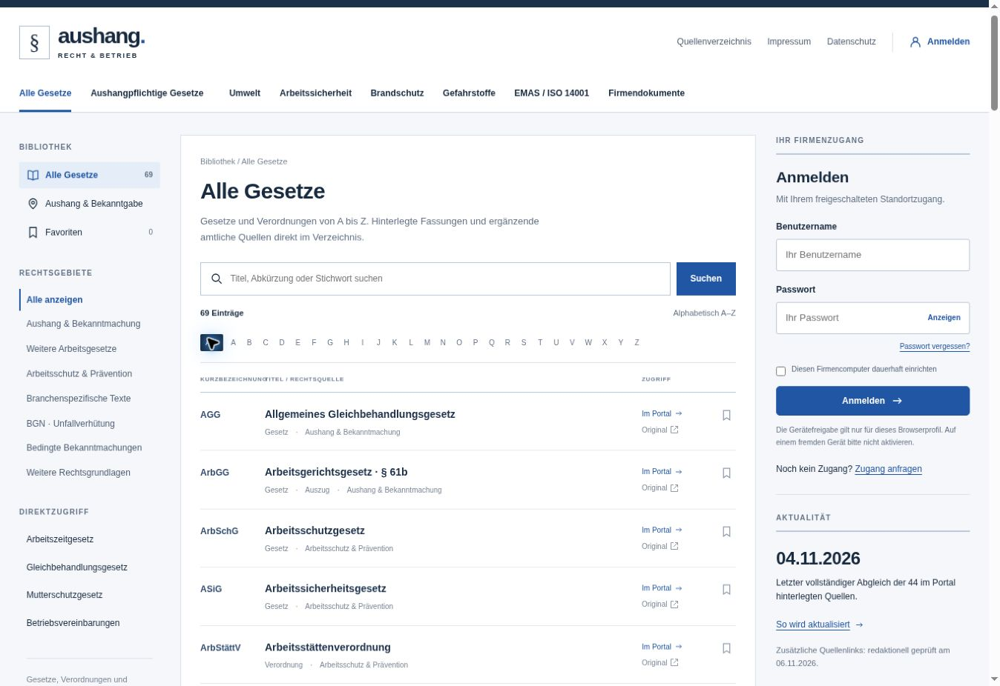

# Prüfung der veröffentlichten Oberfläche

Am 06.11.2026 wurden auf der veröffentlichten Seite die Startansicht mit 69 Rechtsquellen, Suchfilter (Vermögensbildung), A–Z-Filter (M), Aushang-Navigation, EMAS/ISO-Themenseite und der freiwillige Dokumentenbereich ohne Anmeldung geprüft. Das Bild zeigt die neue Startansicht. Die anschließend vervollständigte Zuordnung nach § 21 LadSchlG und § 12 DGUV Vorschrift 1 erweitert den Aushangbereich auf 27 Einträge; die Gestaltung bleibt unverändert.

28 automatisierte Tests sowie TypeScript-Prüfung und Produktionsbuild bestanden. Nach der abschließenden Ergänzung wurden die betroffenen Katalogtests und TypeScript erneut erfolgreich geprüft. Es wurden keine Produktivkonten angelegt, Passwörter verändert oder Firmendokumente hochgeladen.
