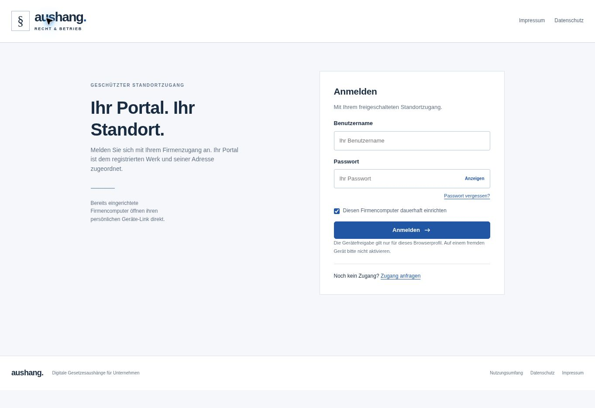

# Prüfung des geschützten Werkportals

Die zuvor öffentliche Bibliotheksansicht wurde auf Wunsch des Betreibers durch eine reine Anmeldeseite ersetzt. Am 06.11.2026 wurde die veröffentlichte Version 11 geprüft:

- Ohne Sitzung zeigt die Startseite nur Anmeldung, Zugangsanfrage, Wiederherstellung und rechtliche Anbieterinformationen.
- Der direkte Link `/#alle-gesetze` öffnet keine Bibliothek.
- `/api/public/catalog` liefert ohne Anmeldung ausschließlich eine Anmeldeaufforderung.
- `/quellen` leitet ohne Sitzung zu `/#anmelden` weiter.

Die automatisierten Prüfungen verwenden die tatsächliche Oberfläche zusammen mit der API und temporären Testkonten: Passwortanmeldung und verifizierte Gerätesitzungen öffnen die Aushang-Startseite des registrierten Werks. Favoriten werden geladen; Listen-, Themen-, Dokument-, Konto- und Leseransichten besitzen eine Suche. Abmelden entfernt die geladenen Standortinhalte. Einschließlich der ergänzten UI-Szenarien bestehen 33 Tests; TypeScript und Produktionsbuild sind erfolgreich.

Es wurden für die Browserkontrolle keine Produktivkonten angelegt oder Passwörter geändert. Die angemeldeten Abläufe wurden gegen die echte API im isolierten Testsystem geprüft.
