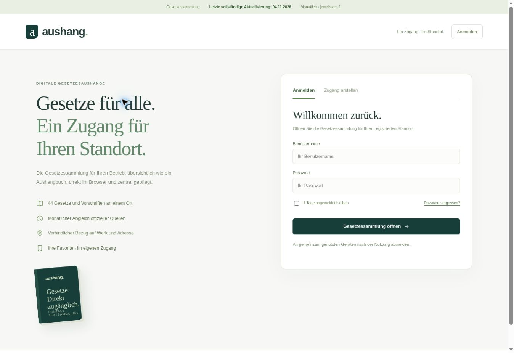

# Produktionsprüfung – 04.11.2026

Live: https://gesetzesaushang-osi-demo.umitdrmz22.chatgpt.site/

Der veröffentlichte Stand ist ohne ChatGPT-Anmeldeschranke direkt erreichbar. Die eigene Produktanmeldung schützt die Konten und die Gesetzessammlung. Keine realen Kundenkonten wurden für die Vorschau angelegt.

## Nachgewiesene Prüfungen

- 12 automatisierte Tests, TypeScript-Prüfung und Produktionsbuild erfolgreich.
- Registrierung mit serverseitigen Standort-Pflichtfeldern, sichere Sitzungen, kontogetrennte Favoriten, Passwortwechsel und einmalige Wiederherstellung geprüft.
- Vollständiger produktiver Quellenlauf: 44/44 offizielle Quellen geladen, serverseitig geprüft, veröffentlicht und Status erfolgreich zurückgelesen. Aktive Run-ID: `4dad545a-3e26-45bb-bce0-28ebeddff7b9`.
- Ein absichtlich bzw. tatsächlich fehlgeschlagener/unvollständiger Quellenlauf lässt aktive Texte und Erfolgsdatum unverändert.
- Aktivierter monatlicher Sites-Auftrag: `Automation_fba510e0ea6c81918ff85a91615ad462`, jeweils am 1. um 06:00, Zeitzone `Europe/Berlin`, erster Termin 01.12.2026. Verknüpfung und `is_enabled=true` nach Erstellung erneut ausgelesen.
- Die Datumsleiste zeigt den letzten vollständigen erfolgreichen Quellenabgleich, nicht das Datum der letzten Gesetzesänderung.

## Produktgrenzen

Registrierungen sind Pilotzugänge ohne Zahlungsbuchung. Preise, bezahlte Aktivierung und Zahlungsabwicklung wurden nicht festgelegt. Die Geschäftsadresse ist eine Kontozuordnung und keine Prüfung des tatsächlichen Aufenthaltsorts. Öffentliches Recht wird nicht als exklusives Urheberrecht des Betreibers verkauft. Datenschutz-/Anbieterinformationen sind vorhanden; Hosting-/Auftragsverarbeitungs- und Transferbedingungen müssen vor entgeltlichem Rollout konkret geklärt werden.
