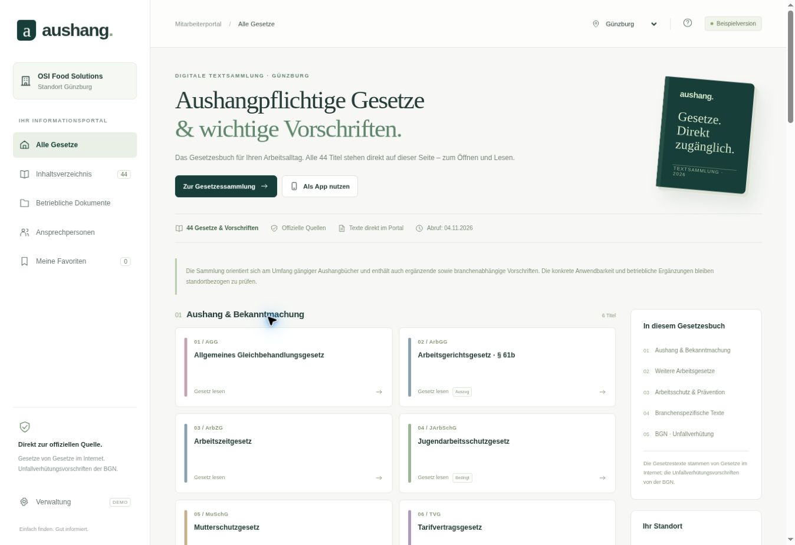

# aushang. – Digitale Gesetzessammlung

Deutschsprachiger, eigenständiger PWA-Entwurf für OSI Günzburg. **Alle 44 Titel stehen auf der Startseite**, ohne Suchschritt. 41 Gesetze und Verordnungen sind aus der offiziellen XML-Quelle hinterlegt, davon drei ausdrücklich gekennzeichnete Auszüge (ArbGG § 61b, BGB, StGB). Zusätzlich sind drei originale BGN-PDFs enthalten: DGUV Vorschriften 1, 2 und 3. Kein offiziell freigegebenes OSI-Portal.

## Starten

`dist/` statisch über HTTP(S) bereitstellen, z. B. `python3 -m http.server 8080 --directory dist`. Die PWA benötigt HTTPS oder localhost. Relative URLs unterstützen auch Unterverzeichnisse bei GitHub Pages. Für eine reine GitHub-Pages-Bereitstellung wird nur `dist/` benötigt; `.openai/hosting.json` gehört zur separaten privaten Vorschau.

## Bedienung

- Auf der Startseite einen Gesetzestitel anklicken: Der hinterlegte Text öffnet sich im Portal. Ein Inhaltsverzeichnis springt zum jeweiligen Paragraphen.
- Originalquelle und Original-PDF bleiben verlinkt; Quelle, Abrufdatum, Standangabe und eventuelle Auszüge werden je Text angezeigt.
- Leseschrift vergrößern, Text drucken, zwischen Gesetzen blättern oder Favoriten merken.
- Zwei lokale Standortprofile und eine Demo-Verwaltung für Bedingungen, Kontakte und HTTPS-Dokumentenlinks.
- JSON-Export/Import mit Bestätigung und Feldvalidierung.
- App-Manifest, PNG-Icons, responsives Layout und Offline-Paket aus den ausdrücklich erfassten öffentlichen Assets. Externe Quellen und Dokumentenlinks benötigen Internet. Authentifizierungsvorgaben des Hostings können Installation und Offline-Betrieb einschränken.

## Umfang und Quellen

Der Umfang orientiert sich an gängigen Sammlungen „Aushangpflichtige Gesetze und weitere wichtige Vorschriften“, insbesondere der [FORUM-Inhaltsübersicht](https://shop.forum-verlag.com/p/aushangpflichtige-gesetze-und-weitere-wichtige-vorschriften/SW13029), mit zusätzlichen für Produktionsbetriebe nützlichen Vorschriften. Es wurden keine Verlagserläuterungen, Buchlayouts oder kommerziellen Textbearbeitungen übernommen.

Die Gesetzestexte stammen ausschließlich aus **Gesetze im Internet**. `dist/source-manifest.json` dokumentiert die einzelnen URLs, SHA-256-Werte der bezogenen XML-Dateien, Abrufdaten, Standangaben und die Auswahl bei Auszügen. Tabellen werden als Bildschirmtabellen umgesetzt; für unverändertes Quellenlayout und enthaltene Grafiken wird die jeweilige Original-PDF verlinkt. Abruf: 04.11.2026; kein laufender Aktualitätscheck.

Die BGN-PDFs sind über die [Vorschriftenübersicht der BGN](https://www.bgn.de/praevention-arbeitshilfen/praxishilfen-service/vorschriften-und-arbeitssicherheitsinformationen/unfallverhuetungsvorschriften) bezogen. Ihre Quell-URLs und Dateihashes sind in `dist/bgn-manifest.json` enthalten. Die BGN-Fassung der DGUV Vorschrift 2 ist gültig ab 01.01.2026.

## Quellen manuell erneuern

`python3 scripts/fetch-laws.py --refresh` lädt die offiziellen XML-Fassungen. `python3 scripts/fetch-bgn.py` lädt fehlende BGN-PDFs. Danach Änderungen, Fassungen, Auszüge und Quelldaten prüfen und das Offline-Verzeichnis neu erzeugen. Es gibt absichtlich keinen automatisch laufenden GitHub-Workflow und keinen ungeprüften Veröffentlichungsmechanismus.

## Grenzen des Entwurfs

Browser-lokale Speicherung ist kein Zugriffsschutz und keine serverseitige Trennung echter Firmen. Keine Anmeldung, zentrale Datenbank, Datei-Uploads, zentrale Freigabe oder rechtsverbindliche Aktualitätsbestätigung. Das lokale Änderungsprotokoll ist veränderbar. Nur Beispieldaten verwenden; lokale Angaben sind auf demselben Browser für andere Nutzende zugänglich.

Die Buchsammlung enthält allgemeine Bekanntmachungspflichten **und** bedingte sowie ergänzende Vorschriften. Aufnahme in die Sammlung bedeutet keine allgemeine eigenständige Aushangpflicht für jeden Text. Die konkrete Anwendbarkeit, vollständiger Zugang für alle Beschäftigten und Schichten, geltende Tarifverträge/Betriebsvereinbarungen, Beschwerdestellen und ggf. Aufsichtsangaben sind vor betrieblichem Einsatz zu ergänzen und zu prüfen. Erforderliche Flucht- und Rettungspläne bleiben nach § 4 Abs. 4 ArbStättV vor Ort bereitzustellen.

## GitHub-Ablage

`examples/gesetzesaushang-osi/` im Branch `codex/gesetzesaushang-osi-demo` des Repositories `dokumentmanagement-studio`. Bestehende Module werden nicht verändert. Der Entwurf benötigt keine Pakete und keinen Build-Prozess.

## Vorschau

